<!-- Generated from docs/readme.md by docs/gen_readme.py. Edit the source and regenerate. -->


Omnipy is a type-driven Python library for:

- data parsing, wrangling, visualization, and conversion
- tool and web service interoperability, and
- scalable dataflow orchestration

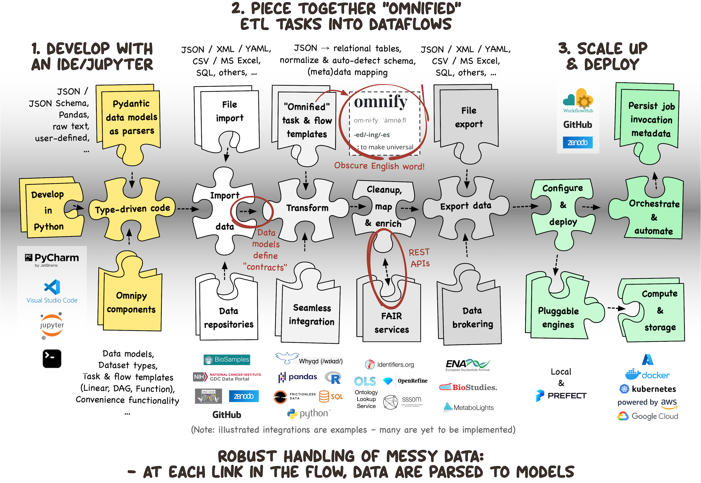

## Why use Omnipy?

**A Readable Contract Between You and Your AI Agent**

AI agents are good at the time-consuming parts of working with research data: reformatting,
cleaning, and integrating. Omnipy gives that work a structure a human can inspect. The agent turns
exploratory code into data models, conversions, and dataflows declared in Python; the data is
validated at every step; and you review the declarations and the data at each junction rather than
the agent's code paths. The declarations are the contract between you and your agent.

**Dataflows, Not Workflows**

Traditional workflows rely on command-line tools and intermediate files, adding complexity to data
pipelines. Omnipy replaces this with dataflows that operate directly in memory or on standard
formats like JSON or CSV. Built on [Pydantic](https://docs.pydantic.dev/) models, Omnipy enhances
data parsing, conversion, and serialization for structured data processing.

**"It's Static Typing!"… "It's Dynamic!"… "It's Omnipy!"**

Omnipy blends Python’s dynamic typing with runtime type safety. Models behave like native Python
structures while ensuring type guarantees without the rigidity of static typing. Defined in Python,
Omnipy models can be as general or specific as needed.

**Parse, Don’t Validate**

Strict validation often breaks pipelines when data is messy. Inspired by
["Parse, don't validate"](https://lexi-lambda.github.io/blog/2019/11/05/parse-don-t-validate/),
Omnipy eagerly parses input into structured models that retain integrity throughout the pipeline.
This approach aligns with the [Robustness Principle](https://devopedia.org/postel-s-law): _"be
liberal in what you accept, and conservative in what you send!"_

**Self-Constraining Data Models**

Omnipy models aren’t just one-time validators. A `Model[list[int]]()` behaves like a list but
ensures its elements are always integers. Every modification parses data to enforce integrity,
rolling back invalid operations automatically.

**Omnify Your Data Pipelines**

Omnipy invites you to ["omnify"](https://www.websters1913.com/words/Omnify) pipelines — break them
into reusable, universal components. By defining dataflows and tasks with structured input and
output models, Omnipy simplifies reuse and promotes good coding practices, improving maintainability
as projects grow. Small, typed, reviewable components are also what an agent should produce.

**Catalog of Components for Interoperability**

Omnipy includes components for tasks like asynchronous API requests with rate limiting and retries,
posting JSON to web services, building paged URLs, keying Datasets by the primary keys of their
records, parsing JSON or tabular data, and flattening nested data into relational tables.
Integration with REST APIs and data wrangling/analysis tools like
[Pandas](https://pandas.pydata.org/) simplifies interoperability across diverse systems. Expect the
catalog to grow as the community expands!

**Built to Scale**

Omnipy’s hierarchical `Dataset` structure simplifies batch processing of directory-based data,
including parsing, serialization, and metadata handling. With
built-in [Prefect](https://www.prefect.io/) support, Omnipy scales seamlessly from local experiments
to distributed deployment, meeting the demands of projects large and small.

## Installing Omnipy

1. Make sure that your Python version is between `3.11.4` and `3.15`, e.g.:

    ```bash
    $ python --version
    Python 3.15
    ```

2. Create and activate a virtual environment for your project, e.g.:

    ```bash
    $ python -m venv myproject
    $ source myproject/bin/activate
    ```

    > TIP:
    > - If you need help with setting up a virtual environment, check out the relevant section in
    >   the [FastAPI documentation](https://fastapi.tiangolo.com/virtual-environments/).
    >   _(Please note that Omnipy does not depend on FastAPI, it is just that their documentation is
    >   excellent!)_
    > - If you are using Omnipy in a [Jupyter notebook](https://jupyter.org/), you can most likely
    >   skip this step.

3. Install Omnipy using:
    ```bash
    $ pip install omnipy
    ```

4. If you work with a coding agent, install the Omnipy skills into your project, running in the
   project directory:
    ```bash
    $ python -m omnipy.skills install
    ```

    This links the skills shipped with Omnipy into `.agents/skills/`, where most agents read them,
    so that they follow Omnipy through upgrades. Add `--claude` for Claude Code, which reads
    `.claude/skills/`, and see `python -m omnipy.skills --help` for listing the skills and other
    options.

Omnipy works with both Pydantic 1 and 2. With Pydantic 2 installed, it runs through Pydantic's v1
compatibility layer; Pydantic 2 models are not supported yet.

## Getting started

The examples below run when the documentation is built, and their output is shown here as images. The [documentation site](https://omnipy.readthedocs.io/) shows the same page with live output, and is the place to copy from.

### Parse data into a model

To define an Omnipy data model, simply concretize the generic `Model` class by specifying a
data type in brackets, e.g. `Model[list[int]]`.

The following creates a data model of a list of integers, and parses some data into that model:

```pycon
>>> import omnipy as om
>>> data = (123, '234', 345.0)  # Note that the input data is a tuple of mixed types
>>> data_as_list_of_ints = om.Model[list[int]](data)
>>> data_as_list_of_ints  # The data is now parsed into a list of integers
```

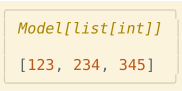

### Build the URLs of a web API

Let's work with river samples from the
[water-sample harmonization example](https://github.com/fairtracks/omnipy/tree/main/tests/integration/novel/full/water_sample_harmonization).
A water quality API would return such samples in pages. Here the two pages are JSON files in the
Omnipy repository, so the walkthrough runs as it stands from any Python console.

An `HttpUrlModel` holds a URL as structured fields, so the path is edited in place instead of by
string formatting:

```pycon
>>> import omnipy as om
>>> ui_config = om.runtime.config.data.ui.browser
>>> ui_config.color.style = om.DarkHighContrastColorStyles.MEASURED_DARK_T16
>>> ui_config.color.solid_background = True

>>> river_data = om.HttpUrlModel('https://raw.githubusercontent.com/fairtracks/omnipy/main')
>>> river_data.path // 'docs' // 'examples' // 'river_samples'

>>> river_page_0 = om.HttpUrlModel(river_data)
>>> river_page_0.path // 'page_0.json'
>>> river_page_0
```

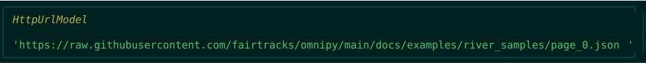

A second page differs only in its file name. An `HttpUrlDataset` collects the URLs under names
that will also name the responses:

```pycon
>>> river_page_1 = om.HttpUrlModel(river_data)
>>> river_page_1.path // 'page_1.json'

>>> page_urls = om.HttpUrlDataset(river_page_0=river_page_0, river_page_1=river_page_1)
>>> page_urls
```

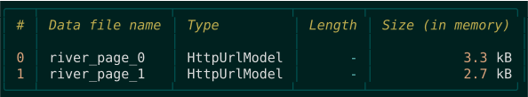

Such Datasets are also built by the catalog: `GeneratePagedUrlsModel` from a page or item count
for APIs with many pages, and the `get_github_repo_urls` task from a directory listing on GitHub.

### Load the pages

A Dataset loads all its URLs, keeping the responses under the URL names. A `JsonDataset` parses
the responses as JSON, including when the server sends them as plain text, as GitHub does here:

```pycon
>>> pages = om.JsonDataset.load(page_urls)
>>> pages
```

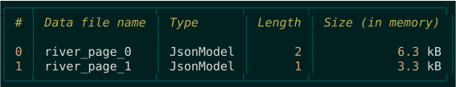

A Dataset's `peek()` shows the contents of its items side by side:

```pycon
>>> pages.peek()
```

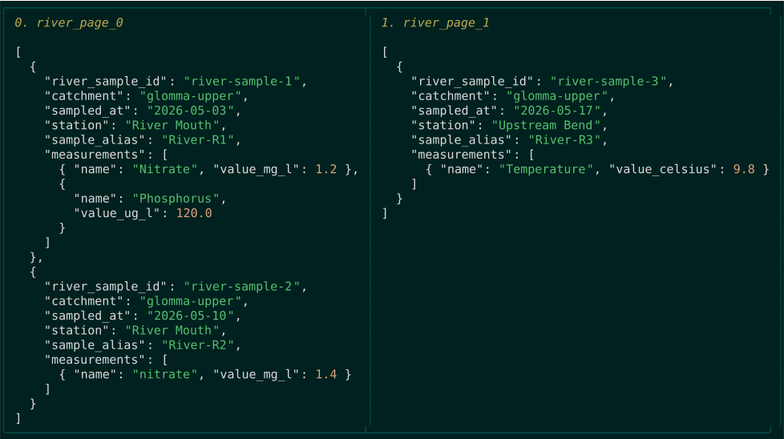

These are synchronous console calls. In a notebook or other running event loop,
use `await` with `.load()`.

### Give the samples a type

Models mimic their wrapped values, so we can index the loaded JSON directly.
The second measurement in the first sample is phosphorus, reported in µg/L:

```pycon
>>> raw_measurement = pages['river_page_0'][0]['measurements'][1]
>>> raw_measurement
```

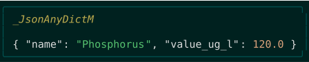

JSON types alone do not describe what a measurement means. Pydantic records give the fields a
contract, and Omnipy Models keep that contract active while we work. The measurements come in three
shapes, which a union of records tells apart by their fields. A Dataset keyed by the sample id is
declared on top of the records: it merges the pages and rejects duplicate ids. `mimics` makes the
wrapped interfaces visible to editors and type checkers; at runtime, field access works through
the Models themselves.

```python
from typing import Literal

import omnipy as om
import omnipy.util.pydantic as pyd


class RiverMeasurementRecord(pyd.BaseModel):
    name: str


class RiverTempMeasurementRecord(RiverMeasurementRecord):
    value_celsius: float


class RiverMgConcMeasurementRecord(RiverMeasurementRecord):
    value_mg_l: float


class RiverUgConcMeasurementRecord(RiverMeasurementRecord):
    value_ug_l: float


RiverMeasurementRecordType = (
    RiverTempMeasurementRecord | RiverMgConcMeasurementRecord | RiverUgConcMeasurementRecord
)


class RiverSampleRecord(pyd.BaseModel):
    river_sample_id: str
    catchment: str
    sampled_at: om.DateModel
    station: str
    sample_alias: str
    measurements: list[RiverMeasurementRecordType]


@om.mimics(om.Dataset[om.Model[RiverSampleRecord]])
class RiverSamplesById(
    om.MergeListsOfRecordsIntoDatasetByPrimaryKeyModel[
        om.PrimaryKey[Literal['river_sample_id']], RiverSampleRecord
    ]
): ...
```
**_Models #1: the sample and measurement records, and a Dataset of samples keyed by their id._**

Converting the loaded pages to the new Dataset parses them into typed samples:

```pycon
>>> samples = pages.to(RiverSamplesById)
>>> samples
```

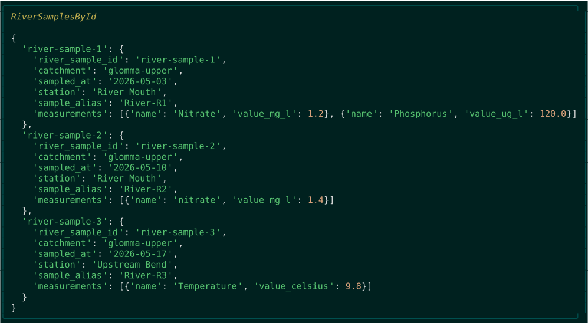

```pycon
>>> samples['river-sample-1']
```

![Display of samples['river-sample-1']](docs/images/readme/08-samples-river-sample-1.svg)

### Work with the Dataset

A Dataset is a mapping of Models. Items are read through their record fields, and several items
are selected by a list of keys or a slice:

```pycon
>>> print(samples['river-sample-3'].station)
Upstream Bend
```

```pycon
>>> print({key: sample.station for key, sample in samples.items()})
{'river-sample-1': 'River Mouth', 'river-sample-2': 'River Mouth', 'river-sample-3': 'Upstream Bend'}
```

```pycon
>>> river_mouth_samples = samples[['river-sample-1', 'river-sample-2']]
>>> river_mouth_samples
```

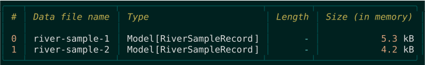

### Edit safely, without unpacking

Omnipy Models are self-constraining: assigning through the mimicked interface
parses the new value against its field type. An invalid concentration raises a
validation error:

```pycon
>>> phosphorus = samples['river-sample-1'].measurements[1]
>>> phosphorus
```

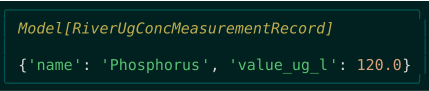

```pycon
>>> phosphorus.value_ug_l = 'not a number'
ValidationError: 2 validation errors for Model[RiverUgConcMeasurementRecord]
__root__ -> value_ug_l
  value is not a valid float (type=type_error.float)
__root__
   (type=assertion_error)
```

In interactive mode, the failed edit is rolled back to the last valid snapshot.
The measurement is still `120.0 µg/L`; we do not need to reload the response.
A numeric string, on the other hand, can be parsed as a float. Let's correct the
reading to `150.0 µg/L`. The measurement is part of the sample, so the correction
is visible there too:

```pycon
>>> phosphorus.value_ug_l = '150.0'

>>> samples['river-sample-1'].measurements[1]
```

![Display of samples['river-sample-1'].measurements[1]](docs/images/readme/11-samples-river-sample-1-measurements-1.svg)

### Convert to a common representation

Other sources use different field names and units. A `ConverterModel` makes a
conversion reusable and validates its output. One mapper normalizes a measurement, matching on
its record type to convert µg/L to mg/L; another normalizes a sample, converting all its
measurements. A Dataset of the sample mapper converts whole batches of samples:

```python
class NormalizedMeasurementRecord(pyd.BaseModel):
    type: Literal['nitrate', 'phosphorus', 'temperature']
    value: float
    unit: Literal['mg/L', 'deg_C']


@om.mimics(NormalizedMeasurementRecord)
class NormalizedRiverMeasurementMapper(
    om.ConverterModel[RiverMeasurementRecordType, NormalizedMeasurementRecord]
):
    @classmethod
    def _convert(cls, data: RiverMeasurementRecordType) -> NormalizedMeasurementRecord:
        match data:
            case RiverTempMeasurementRecord():
                return NormalizedMeasurementRecord(
                    type=data.name.lower(), value=data.value_celsius, unit='deg_C'
                )
            case RiverMgConcMeasurementRecord():
                return NormalizedMeasurementRecord(
                    type=data.name.lower(), value=data.value_mg_l, unit='mg/L'
                )
            case RiverUgConcMeasurementRecord():
                return NormalizedMeasurementRecord(
                    type=data.name.lower(), value=data.value_ug_l / 1000, unit='mg/L'
                )


class NormalizedSampleRecord(pyd.BaseModel):
    sample_key: str
    monitoring_date: om.DateModel
    location_name: str
    measurements: list[NormalizedMeasurementRecord]


@om.mimics(NormalizedSampleRecord)
class NormalizedRiverSampleMapper(om.ConverterModel[RiverSampleRecord, NormalizedSampleRecord]):
    @classmethod
    def _convert(cls, data: RiverSampleRecord) -> NormalizedSampleRecord:
        return NormalizedSampleRecord(
            sample_key=data.sample_alias.lower(),
            monitoring_date=data.sampled_at,
            location_name=data.station,
            measurements=list(NormalizedRiverMeasurementMapper.convert_all(data.measurements)),
        )


class NormalizedRiverSamples(om.Dataset[NormalizedRiverSampleMapper]): ...
```
**_Models #2: ConverterModel subclasses normalizing a measurement and a sample, and a Dataset
of normalized samples._**

```pycon
>>> normalized = NormalizedRiverMeasurementMapper(phosphorus)
>>> normalized
```

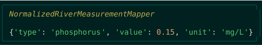

The corrected reading is now `0.15 mg/L`. Conversion follows the types: `.to()` converts a
Dataset into another Dataset or Model class, here all the samples at once, and then into Pandas
tables:

```pycon
>>> normalized_samples = samples.to(NormalizedRiverSamples)
>>> normalized_samples['river-sample-1']
```

![Display of normalized_samples['river-sample-1']](docs/images/readme/13-normalized_samples-river-sample-1.svg)

```pycon
>>> tables = normalized_samples.to(om.PandasDataset)
>>> tables['river-sample-1']
```

![Display of tables['river-sample-1']](docs/images/readme/14-tables-river-sample-1.svg)

### Compose tasks and flows

The steps so far form a dataflow: fetch the pages, key the samples, normalize them, and tabulate.
Omnipy composes dataflows from tasks and from the data classes themselves. A task wraps a
function. A linear flow declares its stages in order, and Model and Dataset classes are stages in
their own right, as constructing them is the conversion:

```python
@om.TaskTemplate()
async def fetch_sample_pages(page_urls: om.HttpUrlDataset) -> om.JsonDataset:
    return await om.resolve(om.JsonDataset.load(page_urls))


@om.LinearFlowTemplate(
    fetch_sample_pages,
    RiverSamplesById,
    NormalizedRiverSamples,
    om.PandasDataset,
)
async def harmonize_river_samples(page_urls: om.HttpUrlDataset) -> om.PandasDataset: ...
```
**_Dataflow #1: a task fetching the pages, and a linear flow from URLs to Pandas tables._**

```pycon
>>> tables = harmonize_river_samples.run(page_urls)
>>> tables
```

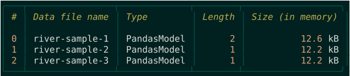

The flow declaration is what a reviewer reads, and what an AI agent working on the pipeline
produces and is held to: the stages, their order, and the types passing between them, with every
Model and Dataset validating its data at its stage. The same flow runs on
[Prefect](https://www.prefect.io/) by setting `om.runtime.config.engine.choice = 'prefect'`;
see [Tutorial 8: Prefect orchestration](https://omnipy.readthedocs.io/en/latest/tutorials/08-prefect-orchestration/).

## Where next

- The full
  [water-sample harmonization scenario](https://github.com/fairtracks/omnipy/blob/main/tests/integration/novel/full/water_sample_harmonization/test_water_sample_harmonization.py)
  extends this walkthrough to river and wastewater sources, reusable child flows, and Pandas tables
  of samples and measurements.
- The
  [sequence data brokering scenario](https://github.com/fairtracks/omnipy/tree/main/tests/integration/novel/full/sequence_data_brokering)
  shows a larger dataflow: a typed submission with Datasets of samples and files, mapped requests
  posted to mock web services, derived status, and DAG child flows. A tutorial based on it is in
  preparation.
- Jupyter notebooks with real-world Omnipy code:
  [ihec_encode](https://github.com/fairtracks/omnipy/blob/main/docs/notebooks/ihec_encode.ipynb),
  [isa_json_data_wrangling_example](https://github.com/fairtracks/omnipy/blob/main/docs/notebooks/isa_json_data_wrangling_example.ipynb),
  and [nobel_idw2025](https://github.com/fairtracks/omnipy/blob/main/docs/notebooks/nobel_idw2025.ipynb).
- [Tutorial 8: Prefect orchestration](https://omnipy.readthedocs.io/en/latest/tutorials/08-prefect-orchestration/) runs a flow on the
  Prefect engine.
- The [Omnipy skills](https://github.com/fairtracks/omnipy/tree/main/.agents/skills) are what a
  coding agent reads to work with Omnipy. The first,
  [omnipy-dataflows](https://github.com/fairtracks/omnipy/blob/main/.agents/skills/omnipy-dataflows/SKILL.md),
  covers designing dataflows: typed contracts first, reusable tasks and flows, and narrative tests
  that double as tutorials. The skills ship with Omnipy, see step 4 of
  [Installing Omnipy](#installing-omnipy) above.
- The workshop
  [Structure your AI-powered research data pipelines with Omnipy](https://www.ub.uio.no/english/courses-events/courses/dsdays/2027/structure-your-ai-powered-research-data-pipelines-wi.html)
  at Digital Scholarship Days 2027, University of Oslo, is where this direction is taken further.
- The [omnipy-examples](https://pypi.org/project/omnipy-examples/) package has stand-alone
  example scripts (`pip install omnipy-examples`, then `omnipy-examples --help`). It is updated
  separately and may lag behind the Omnipy release.
